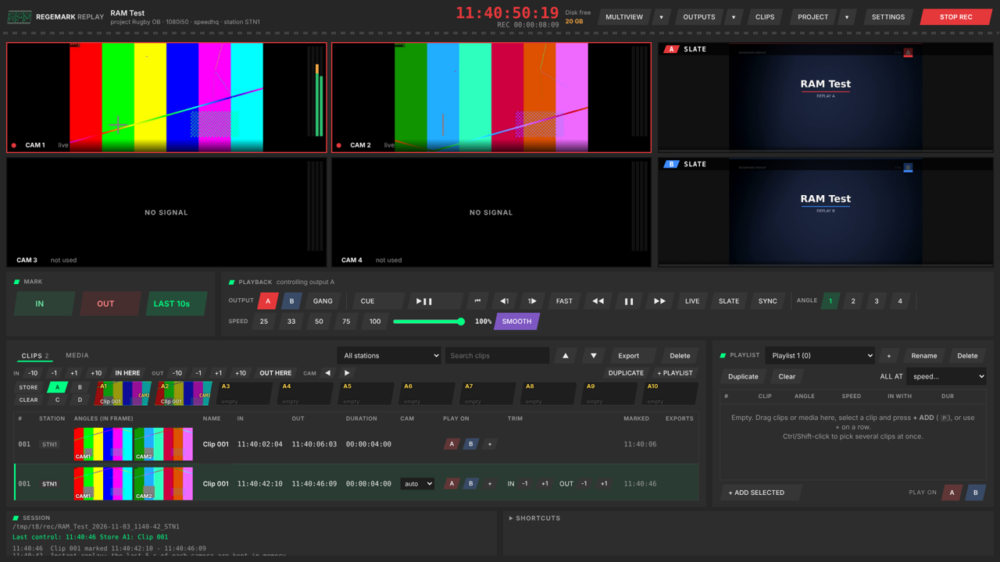
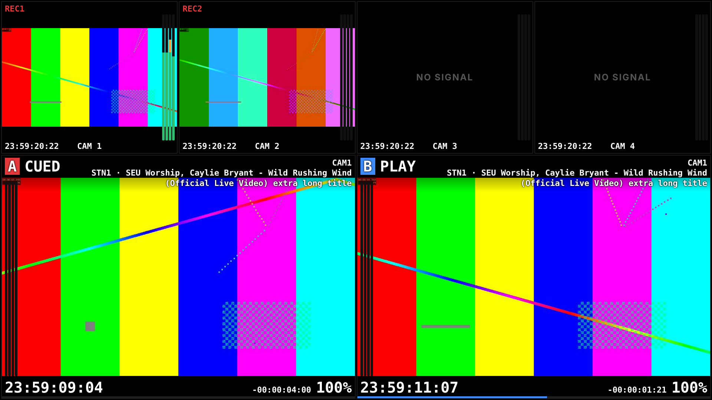

# Regemark Replay

**Live replay, ISO recording and VT playout for Windows** — an EVS / 3Play-style replay system for live sport, church and event productions. Made by RegemarkFP (Regemark Films + Photography, Bloemfontein, South Africa).

## Download

➡ **[Download the latest version](../../releases/latest)** — `RegemarkReplay_Setup_<version>.exe` (or the `.zip` if your browser blocks .exe downloads).

Run the installer: it installs for your Windows user (no administrator rights needed) with Start menu and desktop shortcuts. Updating: run the newer installer — your settings, projects, shortcuts and recordings are kept. Uninstall from *Settings › Apps*.

> Windows may say *"Windows protected your PC"* because the installer is not code-signed yet: click **More info › Run anyway**.

## What it does

- **Up to 8 cameras** in from **NDI** or **DeckLink / capture cards**, recorded as ISOs (SpeedHQ 4:2:2, every frame a keyframe — light on the CPU, instant scrubbing), crash-safe files with timecode in the file name.
- **Replay like an EVS:** jog / shuttle back from LIVE straight into the recording (the last seconds are kept in memory for instant response), mark IN / OUT, play at any speed from -1000% to 1000%, smooth slow motion, FAST JOG.
- **Up to 8 replay outputs** (NDI, plus HyperDeck control for ATEM / Companion), gang control, holding slates, audio routing per output (up to 16 channels, ASIO / Dante).
- **Clips, media and playlists:** clip list with angle thumbnails, per-clip camera, IN / OUT trimming on any clip, duplicate, ingest of video files (watch folder too), playlists with Mix / Dip / Wipe transitions and playlist countdown.
- **Clip stores** (4 pages × 10) with two-state button feedback.
- **Multiview and outputs view** for a second screen, with timecode, countdowns and audio meters.
- **Controllers:** keyboard shortcuts, X-keys (incl. XK-68 Jog & Shuttle) with button lights, MIDI with feedback, macros, Companion / Stream Deck over HTTP.
- **ATEM → DaVinci Resolve:** logs the ATEM's program cuts while recording and exports a Resolve timeline (FCP7 XML) and a multicam clip (FCPXML) of the ISOs.
- **Projects:** save / load the whole show set-up.

## Requirements

- Windows 10 or 11 (64-bit), a recent multi-core CPU, 16 GB RAM or more recommended.
- A fast SSD / NVMe for recordings: about **55 GB per camera per hour** at Standard quality (27 GB Light, 90 GB High).
- **NDI Runtime** or NDI Tools ([ndi.video](https://ndi.video/tools/)) for NDI inputs and outputs.
- **Blackmagic Desktop Video** for DeckLink cards.
- Internet on first start: the app downloads **ffmpeg** once (~100 MB).

## Getting started

1. Install and start Regemark Replay. It opens with test patterns on Cam 1–4.
2. **SETTINGS › Inputs:** click each camera's picture and pick its source (NDI and DeckLink inputs are found automatically, with live thumbnails).
3. **SETTINGS › Show & recording:** choose the recordings folder and quality.
4. Press **REC**. Turn the shuttle (or press `,` / `.` to jog) to go back from LIVE, **I** to mark IN, **O** to mark OUT, **Space** to play.
5. **PROJECT › Save** to keep the set-up.

All shortcuts are listed and editable in **SETTINGS › Controls** (export / import as a file).

## Support & feedback

Found a bug or want a feature? Open an [issue](../../issues). Please include the version (shown in the title bar) and the log file `regereplay.log` from the install folder (`%LOCALAPPDATA%\Programs\Regemark Replay`).

## Credits

- NDI® is a registered trademark of Vizrt NDI AB. Regemark Replay uses the NDI Runtime installed on your PC.
- Video processing by [FFmpeg](https://ffmpeg.org) (downloaded separately on first start, licensed under the GPL / LGPL). SpeedHQ is a NewTek / Vizrt codec, encoded and decoded by FFmpeg.
- DaVinci Resolve, ATEM, DeckLink and HyperDeck are trademarks of Blackmagic Design. EVS and 3Play are trademarks of their owners; Regemark Replay is not affiliated with them.

© 2026 RegemarkFP (Pty) Ltd. See [LICENSE](LICENSE.md).
